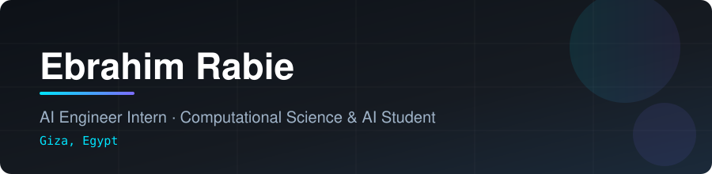

---

AI engineering intern and Computational Science & AI student. I build AI agents, search systems, and the pipelines around them.

## About

I study Computational Science and AI at Zewail City of Science and Technology (graduating July 2028). I'm an AI Engineer Intern at Rawmart, where I build an AI quoting agent for the Egyptian construction market.

I like math, so I enjoy the parts of AI that need it: ranking, retrieval, and evaluation. I'm also interested in using AI for clean-energy problems, like fusion and plasma physics.

I also teach. I was a Calculus teaching assistant for 3 cohorts of 65+ students.

## Currently working on

- **Rawmart quoting agent.** Tool-constrained LLM calls, supplier-price retrieval, and automatic quote generation. I also work on prompts, evaluation, and retrieval to improve accuracy and speed.
- **Rasad.** A civic-tech platform for monitoring Egypt's informal microbus transit system. I co-founded it with Marwan.
- **Research.** Applying to research internships in AI and computational science.

## Selected work

**[Math Search Engine](https://github.com/ebrahim-rabie)** — A full-stack search system with TF-IDF ranking, Rocchio relevance feedback, and WordNet query expansion over a custom inverted index. Queries run in under 200 ms. Gemini explains the math and Wolfram Alpha solves equations. Python, FastAPI, React.

**[GeoBasira](https://github.com/ebrahim-rabie)** — An air quality tool that uses NASA TEMPO data to show pollution levels across 3 Egyptian regions. I led a team of 6 and built the prototype in 48 hours at NASA Space Apps Cairo 2025.

**[Arabic Digit Recognizer](https://github.com/ebrahim-rabie)** — An MLP trained on MADBase (handwritten Arabic digits). It runs on the phone with TFLite inside a Flutter app, with HSV ink detection and morphological preprocessing.

**[E-Commerce Data Analysis](https://github.com/ebrahim-rabie)** — Scraped 5,000+ products and used graph analysis to find 10+ high-frequency product relationships for cross-sell recommendations.

## What I reach for

| Focus | Tools |
| --- | --- |
| ML / AI engineering | TensorFlow, Keras, scikit-learn, LangGraph, RAG |
| Languages | Python, C++, C, SQL, TypeScript |
| Data and retrieval | Pandas, NumPy, NetworkX, PostgreSQL (pgvector) |
| Serving and tooling | FastAPI, Redis, Ollama, Git, GitHub, Jupyter |
| Product integration | React, Tailwind CSS, Flutter, TensorFlow Lite |

## Experience

- **AI Engineer Intern**, Rawmart (Jul 2026–Present)
- **Green Finance Intern**, CIB Egypt Green Leap Program (Sep–Oct 2025). Selected from 500+ applicants.
- **Data Analysis Intern**, Soualy (Jul–Aug 2025). Built Pandas pipelines that cut manual reporting time by 30%, and Power BI dashboards for leadership.
- **Junior Teaching Assistant, Mathematics**, Zewail City (Feb–Jun 2025)

## Community

- Host and Lead Organizer of the **Hacktoberfest 2026 Hackathon** (MLH × DEV)
- Vice Head of Public Relations, **AWS Student Builder Group** at Zewail City
- Co-Creation Team Member, **OPPO Campus Crew**
- Completed the **IBM Bob 2.0 Hackathon** (lablab.ai)

## 📊 Activity

## Contact

- Happy to talk about AI agents, search and retrieval, research projects, and hackathons.

---

Code in my repositories is open unless a repository says otherwise.
